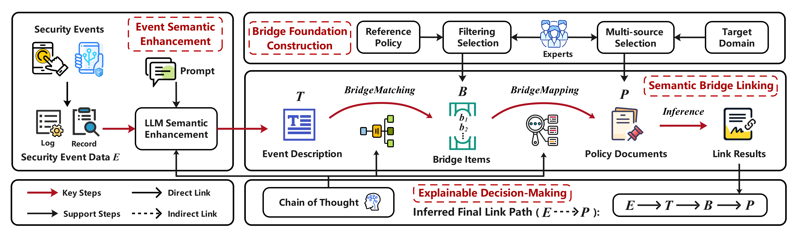

# *SemBridge*: Semantic Bridge for Event-Policy Linking

From Event to Policy: An Automated Semantic Bridging Approach for Security Event-Policy Linking

## 📝 Introduction

We have implemented **_SemBridge_**, an automated and fully auditable method for security event-policy linking and subsequent compliance judgment. Unlike traditional direct matching, *SemBridge* introduces intermediate **"bridge items"** that act as **semantic elements** between concrete security events and abstract regulatory requirements. This design enables **multi-hop, explainable inference**, providing a complete and verifiable logical path (full audit trail) from the occurrence of a security event to the final regulatory conclusion. The method automatically generates comprehensive compliance reports, which not only identify potential policy violations but also furnish **detailed, trace-backed explanations** to facilitate compliance checking and auditing.

**Application Scenarios:** App Log Behaviour Compliance Auditing, Professional Audit Records Compliance Checking, Cybersecurity Events Compliance Analysis, Documentation Materials Compliance Analysis (Supported data types: structured, semi-structured and unstructured data).
<!-- 可选：截图、动图、Logo -->

## 🌟 Core Features 

- 🔗 **Auto-link events to regulations**: Link security events (e.g., app logs or audit records) to relevant privacy regulation clauses (e.g., PIPL article 14).
- 🔍 **Automated compliance checking:** Checking whether security events meet regulatory requirements, such as compliance or violation.
- 📚 **Multi-source regulatory analysis**: Supports joint analysis of regulations across different levels, dimensions, and hierarchies (e.g., PIPL, CSL, DSL, etc.).
- 📑 **Generate link reports**: Export results in JSON format for link inference paths between events and legal clauses.
- ⚡ **Higher efficiency**: Minimizes manual auditing costs, enables rapid output of compliance insights, and supports human-in-the-loop review.
- 🧩 **Operational expandability**: Predefined bridge items and regulatory documents are modular, flexible, and easily updatable to adapt to domain-specific needs and evolving legal requirements.

## ⚙️ Method Workflow
The workflow transforms security event data into auditable compliance decisions through four stages:

- **Event Semantic Enhancement:** We use engineered prompts, iteratively refined based on key insights, to leverage an LLM to perform contextual expansion, generating comprehensive textual representation $T$ that preserve original event semantics while enhancing interpretability.

- **Bridge Foundation Construction:** This module establishes intermediate semantic constructs called *bridge items*. These items serve as pivots between event descriptions and policy clauses. Through an expert-guided process, we curate a set of bridge items $\mathcal{B}$ that capture compliance-relevant concepts at a suitable abstraction level for bidirectional mapping.

- **Semantic Bridge Linking:** As the core analytical component, this module performs multi-stage semantic alignment via three operations: 1) *BridgeMatching* identifies relevant bridge items $\mathcal{B}_{\text{match}} \subseteq \mathcal{B}$ aligned with description $T$. 2) *BridgeMapping* constructs a Relationship Knowledge Graph ($\mathcal{RKG}$) encoding semantic associations between bridge items and policy clauses. 3) *Link Inference* synthesizes these results to generate structured compliance reports linking events to specific policy provisions.

- **Explainable Decision-Making:** This final module ensures transparency through Chain-of-Thought (CoT) reasoning. It generates interpretable justifications for each inference step and extracts complete decision paths, allowing auditors to trace the logical progression from security events to compliance determinations.



## 📂 Project Structure

```bash
SemBridge-v1/
├── BridgeMapping/                          # BridgeMapping and link inference
│   ├── __init__.py
│   ├── compliance_RKG_CoT.json
│   ├── construction_RKG.py                 # constructing RKG (Relationship Knowledge Graph)
│   ├── link_inference.py                   # link inference
│   ├── LLM_MapBridgeToRule.py              # LLM association analysis for bridge items and regulations
│   └── policies_all.json					# regulations data
├── BridgeMatching/                         # BridgeMatching
│   ├── __init__.py
│   ├── BridgeMatch_predict.py              # bridge items match prediction
│   ├── BridgeMatch_trainLLM.py             # training LLM for bridge matching
│   ├── config.json                         # Configuration file
│   └── train_bridge_data.json              # Training data
├── ESE_module/                             # ESE module
│   ├── __init__.py
│   ├── config.json                         # Configuration file
│   └── event_enhance.py                    # event semantic enhancement
├── bridge_items.json                       # Predefined Bridge items
├── end_to_end_sembridge.py                 # main .py for the SemBridge process
├── requirements.txt                 		
└── README.md       
```

## 📊 Dataset Description
The project contains the following data files:

- `bridge_items.json`: This includes the 17 bridge items we designed for personal information protection, consisting of first-level labels `L1`, second-level labels `L2`, natural language descriptions `SD` for the bridge item, and predefined semantic labels `SJ` (denoting the semantic relationship between the input text `T` and the bridge item, such as “compliant” or “violating”). For example, the bridging item `B-01` is: 
```json
    {
      "ID": "B-01",
      "L1": "Lawful Basis for Personal Information",
      "L2": "Individual Consent",
      "SD": "Consent must be voluntary, informed, and explicitly given for personal information (PI) processing.",
      "SJ": ""    
    }
```

- `/BridgeMatching/train_bridge_data.json`: This file contains training data for matching text $T$ with bridge item sets $\mathcal{B}$, used in fine-tuning LLM models to perform _BridgeMatching_ tasks. Due to our annotated data potentially containing confidential company information, we have provided only a few anonymised data examples, detailed as follows:

```json
{"behavior": "Before collecting users' location information, a modal window is displayed showing detailed processing rules and obtaining the user's consent via click.", "compliance_labels": [{"bridge_id": "B-01", "SJ": 1}, {"bridge_id": "B-06", "SJ": 1}]}
{"behavior": "When accessing irs01.com, the user's device initiates encrypted data transmission. The HTTP request parameter includes the encryption identifier `encrypt=1`, utilising the HTTP protocol. Data is transmitted in plaintext format but includes the encryption identifier, involving device information such as IMEI, MAC address, Android ID, and other data.", "compliance_labels": [{"bridge_id": "B-13", "SJ": 0}]}
```

- `/BridgeMapping/policies_all.json`:  This is the data for all regulatory provisions. We have collected regulations at nine different levels and granularities: the Cybersecurity Law (CSL), the Constitution of the People's Republic of China (Constitution), Measures for Determining the Illegal Collection and Use of Personal Information by Apps (MICUPIA), Personal Information Security Specification (GB/T 35273-2020), the Civil Code of the People's Republic of China (Civil Code), Personal Information Protection Law (PIPL), Data Security Law (DSL), Network Data Security Management Regulations (NDSMR), and Measures for the Administration of Personal Information Protection Compliance Audits (PIPCA). For example, a data structure for a clause is as follows:

```json
  {
    "CID": "PIPL-16",
    "PName": "《Personal Information Protection Law of the People's Republic of China》",
    "Cont": "A personal information processor shall not refuse to provide products or services for an individual on the grounds that the individual withholds his consent for the processing of his personal information or has withdrawn his consent for the processing of personal information, except where the processing of personal information is necessary for the provision of products or services."
  }
```

- `/BridgeMapping/compliance_RKG_CoT.json`:  We constructed a relationship knowledge graph mapping bridge items to regulatory clauses using `LLM_MapBridgeToRule.py` and `construction_RKG.py`. The data is stored in `compliance_RKG_CoT.json`. This is a completed relational data set with the following structure:
```json
"compliance_graph": [
    {
      "bridge_id": "B-01",
      "bridge_sd": "Consent must be voluntary, informed, and explicitly given for personal information (PI) processing.",
      "related_laws": [
        {
          "law": "《Personal Information Protection Law of the People's Republic of China》",
          "article": "14",
          "level": "Law",
          "effective_date": "2021-11",
          "relation": "Direct correspondence",
          "compliance_degree": 4.0
        },
        ...
      ]
    },
    ...
]
```


## 🧑‍💻 Demo


## 🚀 Quick Start
This project relies on `Python 3.12` and `CUDA 12.1` and is only supported on **Linux GPU servers**. If using other versions of Python, you will need to adjust the corresponding packages and CUDA versions.
### Install

```bash
# Step 1: Create a virtual environment (recommended)
python -m venv hf-env
source hf-env/bin/activate
pip install --upgrade pip

# Step 2: Install PyTorch (with CUDA 12.1 support)
pip install torch==2.3.0+cu121 torchvision==0.18.0+cu121 \
    --extra-index-url https://download.pytorch.org/whl/cu121

# Step 3: Install the remaining dependencies
pip install -r requirements.txt

# Verify Installation
python -c "import torch; print(torch.__version__, torch.cuda.is_available())"
# Output should be: 2.3.0+cu121 True

```
### Running
**1. End-to-End SemBridge**

​Under the `main/` directory, run `end_to_end_sembridge.py` using the following command.
```bash
python end_to_end_sembridge.py
```

The configuration information is located in the `config.json` files within the `SemBridge-v1/` directory, allowing for flexible configuration and modification. **Note:** We do not provide model files here and LLMs need to be downloaded and configured independently from open-source communities.

**2. Event Semantic Enhancement**

Under `ESE_module/`, the `event_enhance.py` file implements semantic enhancement. Here, we have packaged it as a function that can be directly loaded and used in other files.
```python
from ESE_module.event_enhance import init_enhancer, enhance_event

# using the semantic enhancer
init_enhancer()
enhanced_text = enhance_event(event)    # event as the input structured data
```

**3. _BridgeMatching_**

Under `BridgeMatching/`, the `BridgeMatch_trainLLM.py` file uses `train_bridge_data.json` to fine-tune the LLM. The `BridgeMatch_predict.py` file provides an interface for calling prediction functions.

```bash
# BridgeMatching training
python BridgeMatch_trainLLM.py
```

```python
# BridgeMatching for prediction
from BridgeMatching.BridgeMatch_predict import BehaviorPredictor

predictor = BehaviorPredictor()
result_file = predictor.predict_and_save(enhanced_text)   # enhanced_text as the output of ESE_module
```

**4. _BridgeMapping_**

Under `BridgeMapping/`, `LLM_MapBridgeToRule.py` employs LLM analysis to map relationships between bridging items and regulatory provisions. `construction_RKG.py` constructs a relational knowledge graph based on the output from `LLM_MapBridgeToRule.py`, with results output to `compliance_RKG_CoT.json`. `link_inference.py` calculates and outputs mapping relationships and link analysis results.

```bash
# LLM association analysis
python LLM_MapBridgeToRule.py

# Building RKG 
python construction_RKG.py
```

```python
# link inference
from BridgeMapping.link_inference import build_bridge_to_law_ids, process_behavior_jsonl

# Loading RKG
bridge_to_clauses = build_bridge_to_law_ids(RELATION_DATA_PATH)  # RELATION_DATA_PATH is compliance_RKG_CoT.json

# Analyse event data
process_behavior_jsonl(INPUT_JSONL_PATH, OUTPUT_JSONL_PATH, bridge_to_clauses) # INPUT_JSONL_PATH is Matching bridge item result file, OUTPUT_JSONL_PATH is Link result output file,
```


